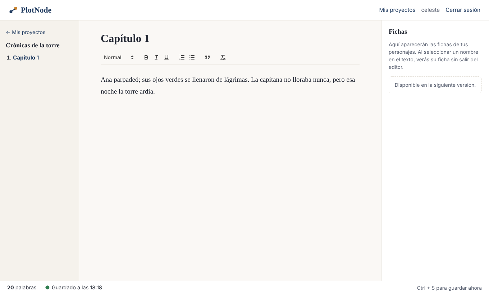

# PlotNode

Entorno de escritura web para escritores de ficción: une el manuscrito y las fichas de personajes en una sola pantalla y avisa cuando la historia se contradice. Proyecto de **Negocios Electrónicos** · Ingeniería de Software · UAZ · Agosto–Diciembre 2026.

**Equipo:** Maria Paula Carrillo Gamboa · Karina Celeste Hernández Pérez



## Estado

| Iteración | Fechas | Objetivo | Estado |
|---|---|---|---|
| 1 | 2 – 4 nov | Cuenta, proyectos y editor con autoguardado | ✅ Hecha ([bitácora](docs/iteraciones/iteracion-1.md)) |
| 2 | 5 – 11 nov | Fichas y panel lateral; publicar en PythonAnywhere | Pendiente |
| 3 | 12 – 18 nov | Auditor con IA, tutorial y pruebas con 6 escritores | Pendiente |

El backlog completo está en [`docs/entregables/PlotNode - Product Backlog.xlsx`](docs/entregables/).

## Tecnologías (todo gratis)

Python 3.12+ · Django 5.2 LTS · SQLite · Quill 2 (editor) · GitHub Actions · PythonAnywhere (plan gratuito) · API de Gemini en su nivel gratuito (iteración 3).

## Correr el proyecto en tu computadora

Necesitas **Python 3.12 o más nuevo** y **Git**.

```bash
git clone https://github.com/<usuario>/plotnode.git
cd plotnode

# 1. Entorno virtual
python -m venv .venv
# Windows:
.venv\Scripts\activate
# Mac / Linux:
source .venv/bin/activate

# 2. Dependencias
pip install -r requirements.txt

# 3. Configuración local
#    Windows: copy .env.example .env      Mac/Linux: cp .env.example .env
#    (el .env de ejemplo ya trae DEBUG=True para trabajar en local)

# 4. Base de datos y usuario administrador
python manage.py migrate
python manage.py createsuperuser

# 5. Levantar el servidor
python manage.py runserver
```

Abre <http://127.0.0.1:8000>. El panel de administración está en <http://127.0.0.1:8000/admin/>.

### Pruebas

```bash
python manage.py test
```

Las mismas pruebas corren solas en GitHub (pestaña **Actions**) cada vez que alguien sube cambios o abre un Pull Request.

## Subir el repositorio a GitHub (una sola vez)

1. En GitHub crea un repositorio **vacío** llamado `plotnode` (sin README, sin .gitignore).
2. En la carpeta del proyecto:
   ```bash
   git remote add origin https://github.com/<tu-usuario>/plotnode.git
   git push -u origin main --tags
   ```
3. En **Settings → Collaborators**, invita a tu compañera.
4. Recomendado: en **Settings → Branches**, protege `main` para que solo entren cambios por Pull Request (en cuentas gratuitas puede requerir que el repositorio sea público; si es privado, acuerden no hacer push directo a `main`).

## Cómo trabajamos (GitHub Flow)

1. Toma una historia del backlog y crea una rama con su ID:
   ```bash
   git checkout main && git pull
   git checkout -b feature/HU-07-fichas
   ```
2. Haz commits pequeños que empiecen con el ID: `HU-07: modelo y formulario de fichas`.
3. Corre `python manage.py test` antes de subir.
4. `git push -u origin feature/HU-07-fichas` y abre un **Pull Request**.
5. La otra integrante revisa; cuando las pruebas pasan en Actions, se hace merge a `main`.
6. Al cerrar cada iteración: `git tag v0.2-iteracion2 && git push --tags` y se escribe la bitácora en `docs/iteraciones/`.

**Nunca subas el archivo `.env`** (ya está en `.gitignore`). Las claves solo viven ahí.

## Estructura

```
plotnode/        configuración (settings.py, urls.py)
core/            app principal
  models.py      Perfil, Proyecto, Capitulo, Ficha, Atributo, Alerta, Evento
  views.py       páginas y endpoints JSON
  templates/     plantillas de la app
  static/core/   CSS, JavaScript del editor y Quill
  tests/         pruebas automáticas
templates/       plantilla base y pantallas de cuentas
docs/            entregables, bitácoras de iteración y capturas
```

## Notas

- **Recuperar contraseña:** el plan gratuito de PythonAnywhere no permite enviar correos por SMTP, así que el enlace se imprime en la consola del servidor. Si un tester olvida su contraseña, restablécela desde `/admin/`.
- **Seguridad:** cada consulta filtra por el usuario con sesión; un proyecto o capítulo ajeno responde 404. El autoguardado exige el token CSRF.
