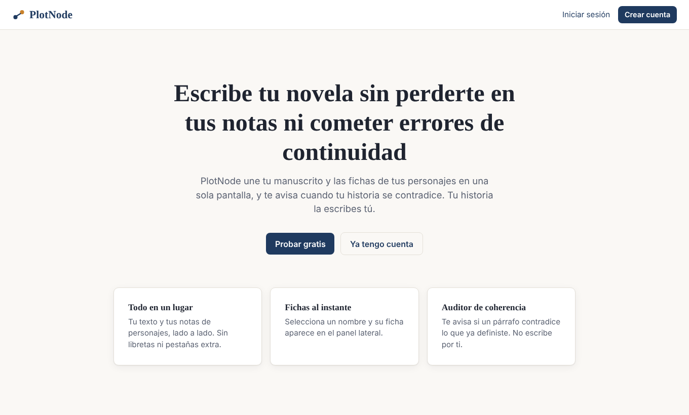
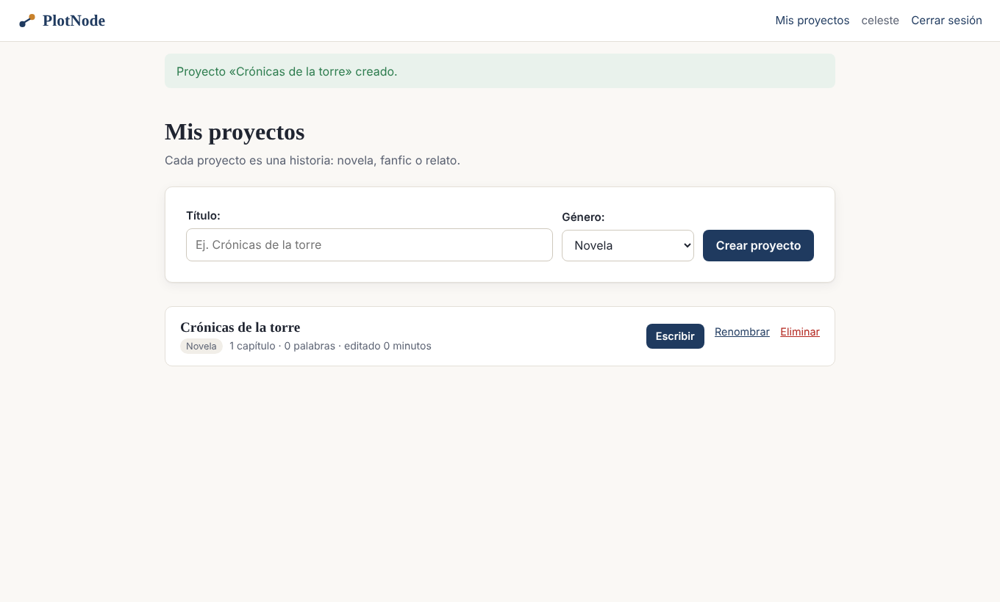
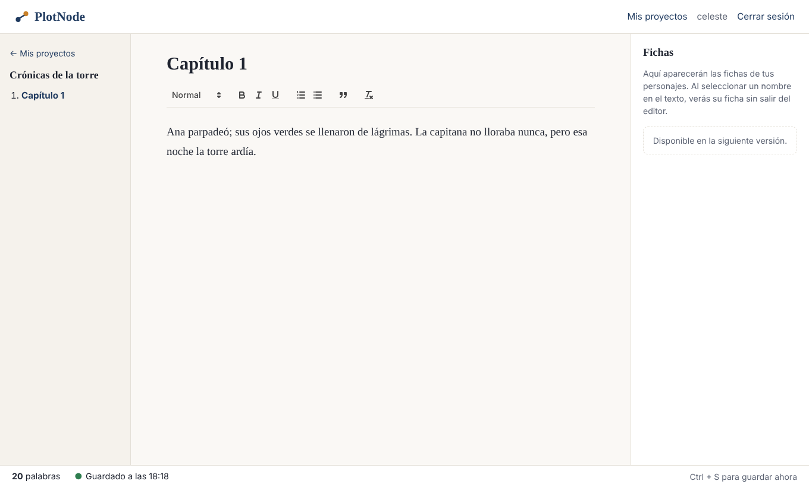

# Iteración 1 · Lun 2 – Mié 4 de noviembre de 2026

**Objetivo:** un escritor puede crear su cuenta, abrir un proyecto y escribir en el editor con autoguardado.
**Revisión:** miércoles 4 de noviembre · semana de puente (2 nov, Día de Muertos).
**Versión:** etiqueta `v0.1-iteracion1`.

## Historias terminadas (14 de 14 puntos)

| ID | Historia | Pts | Evidencia |
|---|---|---|---|
| T-01 | Repositorio, entorno y cuentas | 2 | Proyecto Django 5.2, `.env.example`, GitHub Actions (`.github/workflows/tests.yml`) |
| T-02 | Modelos, migraciones y acceso por usuario | 2 | `core/models.py`, migración `0001_inicial`, admin; pruebas de acceso |
| HU-02 | Registro e inicio de sesión con correo | 3 | Registro, login, logout y recuperación de contraseña |
| HU-04 | Gestionar proyectos narrativos | 2 | Crear, renombrar y eliminar; cada proyecto nace con "Capítulo 1" |
| HU-06 | Editor de texto con autoguardado | 5 | Quill, guardado a los 3 s, Ctrl+S, indicador de estado, contador de palabras |

## Pruebas

- **21 pruebas automáticas** (`python manage.py test`), todas pasan. Cubren: registro, login y logout, correo repetido, vistas que piden sesión, CRUD de proyectos, autoguardado, conteo de palabras, datos inválidos, CSRF y acceso a proyectos y capítulos ajenos (404).
- **Prueba en navegador:** registro → crear proyecto → escribir 20 palabras → el indicador pasa de "Cambios sin guardar" a "Guardado" → recargar la página → el texto sigue ahí con el mismo conteo. Sin errores en la consola. La página de inicio no se desborda en celular (390 px).

## Capturas

| Inicio | Proyectos | Editor |
|---|---|---|
|  |  |  |

## Guion de la demo (3 minutos)

1. Abrir la página de inicio y pulsar **Probar gratis**.
2. Crear una cuenta nueva (se entra directo a *Mis proyectos*).
3. Crear un proyecto, p. ej. "Crónicas de la torre".
4. Pulsar **Escribir**, teclear un párrafo y señalar el contador de palabras y el indicador "Cambios sin guardar → Guardado".
5. Recargar la página: el texto sigue ahí.
6. Mostrar en GitHub el historial de commits (uno por historia) y la pestaña **Actions** con las pruebas en verde.

## Decisiones y cambios

- El panel lateral de fichas ya ocupa su lugar en el editor, pero se llena en la iteración 2.
- Quill se incluye dentro del repositorio (no por CDN) para que la app funcione aunque el CDN falle.
- La recuperación de contraseña imprime el enlace en la consola, porque el plan gratuito de PythonAnywhere no permite SMTP.

## Pendiente para la iteración 2 (5 – 11 nov)

HU-05 capítulos (crear, renombrar, ordenar) · HU-07 fichas de personaje · HU-09 panel lateral · HU-10 ficha al seleccionar un nombre · HU-18 registro de eventos · T-03 prueba del auditor con Gemini · HU-01 landing con lista de espera · T-04 guion de pruebas · T-06 despliegue en PythonAnywhere.

## Retrospectiva (llenar el miércoles en equipo)

- **¿Qué salió bien?**
- **¿Qué hay que mejorar?**
- **Acciones para la iteración 2:**
